<a href="https://luisrobertoportifolio.com.br">portfólio</a> &nbsp;·&nbsp; <a href="https://outframe.dev">outframe.dev</a> &nbsp;·&nbsp; <a href="https://www.linkedin.com/in/luis-roberto-cardoso-trindade-2852891b3/">linkedin</a> &nbsp;·&nbsp; <a href="https://www.instagram.com/lu1sr0b/">@lu1sr0b</a> &nbsp;·&nbsp; <a href="mailto:luiscardoso946@gmail.com">luiscardoso946@gmail.com</a>



<a href="https://meuclaudinho.com.br"></a>

  


<a href="https://powerprih.com"></a><a href="https://www.calculadoradajustica.com.br"></a><a href="https://www.sigmaone.com.br"></a><a href="https://cris.calmaurgente.com.br"></a><a href="https://biadevendas.com.br"></a><a href="https://meajudai.chat"></a><a href="https://xotifala.com"></a><a href="https://acheodominio.com.br"></a><a href="https://matriculas.escolinhapingodegente.com.br"></a><a href="https://voe-com-a-outframe.vercel.app"></a>

clique num projeto pra abrir o site · os cases completos estão em <a href="https://luisrobertoportifolio.com.br">luisrobertoportifolio.com.br</a>

